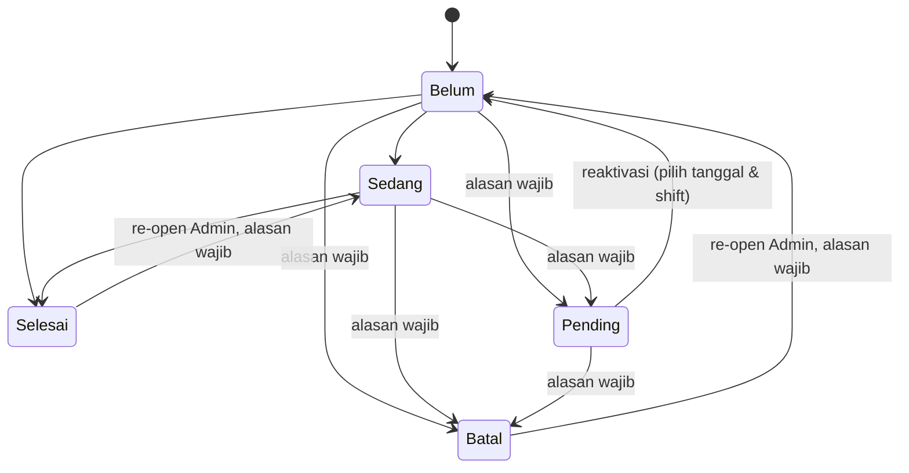
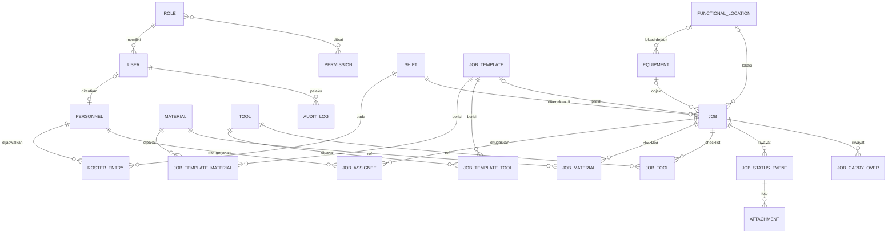

# Business Requirements Document (BRD)
## Sistem Manajemen Shift & Dashboard Pekerjaan Harian

| | |
|---|---|
| Versi | 1.0-draft |
| Tanggal | 9 November 2026 |
| Status | Draft untuk review sponsor |
| Penyusun | Product Owner & Developer (solo) |
| Sponsor / Penyetuju | Kepala Departemen & Kepala Divisi RIM (Railway Infrastructure Maintenance) |
| Target go-live | Kuartal 1 2027 (paling lambat 31 Maret 2027) |
| Dokumen pendamping | `AGENTS.md` (aturan kerja AI), `PROGRESS.md` (progres & timeline), `.opencode/` (skill & command) |

> Aturan dokumen: BRD ini adalah sumber kebenaran **apa** yang dibangun. Perubahan requirement hanya oleh Product Owner dan wajib dicatat di bagian 22 (Riwayat Keputusan) serta `PROGRESS.md`.

---

## 1. Ringkasan Eksekutif

Pengelolaan shift, personel, pekerjaan harian, serta persiapan material dan tools saat ini **sepenuhnya manual**. Dibangun sebuah aplikasi web internal yang:

1. menyusun **roster mingguan** personel (organik dan TAD) untuk 3 shift;
2. merencanakan dan memantau **pekerjaan per shift** lengkap dengan checklist kelengkapan material dan tools;
3. menampilkan **dashboard harian** di layar ruangan yang dapat diakses semua orang di jaringan internal;
4. memberi atasan **pemantauan realtime**;
5. mendukung **mass import via Excel**, **role & permission yang dapat dikelola**, **activity log untuk audit**, dua bahasa (Indonesia/Inggris), dan tema per pengguna.

Aplikasi hanya berjalan di jaringan internal, di server Ubuntu khusus, dibangun oleh satu developer dengan bantuan AI (vibe coding) memakai opencode.

## 2. Latar Belakang & Masalah

| # | Kondisi saat ini | Dampak |
|---|---|---|
| 1 | Roster dan jadwal disusun manual | Memakan waktu, rawan salah, sulit diubah saat ada perubahan dadakan |
| 2 | Daftar pekerjaan harian tidak terpusat | Pekerjaan bisa terlewat, tidak ada gambaran satu layar |
| 3 | Persiapan material/tools tidak terstruktur | Pekerjaan tertunda karena perlengkapan tidak siap |
| 4 | Serah terima antar-shift informal | Pekerjaan belum selesai tidak terlacak ke shift berikutnya |
| 5 | Atasan tidak punya pemantauan langsung | Keputusan berdasarkan laporan lisan/terlambat |
| 6 | Tidak ada jejak siapa mengubah apa | Sulit audit dan menelusuri kesalahan |

## 3. Tujuan Bisnis & Indikator Keberhasilan

| ID | Tujuan | Indikator | Target | Baseline |
|---|---|---|---|---|
| G1 | Mempercepat penyusunan roster & jadwal mingguan | Waktu menyusun roster + jadwal pekerjaan per minggu | **Usulan: turun ≥ 50%** (ditetapkan final oleh PO sebelum Phase 3) | **Belum diketahui, wajib diukur sebelum Phase 3** |
| G2 | Tidak ada pekerjaan terlewat | Jumlah pekerjaan tanpa status akhir yang "hilang" (tidak terbawa dan tidak Selesai/Pending/Batal) | 0 per minggu | n/a |
| G3 | Serah terima antar-shift rapi | Persentase pekerjaan terbawa yang punya catatan serah terima tercatat | 100% | n/a |
| G4 | Atasan dapat memantau langsung | Dashboard atasan menampilkan data ≤ interval refresh | ≤ 30 detik tertinggal | n/a |
| G5 | Akuntabilitas | Perubahan data penting tercatat di activity log | 100% | n/a |

## 4. Ruang Lingkup

### 4.1 Dalam lingkup (semua wajib hadir saat go-live, tidak ada fase 2)
Akun & autentikasi, role & permission, master data (personel, shift, equipment, functional location, material, tools, template pekerjaan), roster mingguan, pekerjaan & status & carry-over & serah terima, foto opsional, mass import Excel, dashboard layar ruangan, dashboard atasan, activity log, pengaturan sistem (termasuk retensi data), dua bahasa, tema, backup.

### 4.2 Di luar lingkup
Absensi/kehadiran aktual · validasi aturan roster (jam kerja, istirahat, kompetensi) · manajemen stok/inventori · integrasi SAP atau sistem lain · aplikasi mobile native · notifikasi WhatsApp/email · target jam per pekerjaan · manajemen cuti · akses dari internet · shift ganda (lembur dua shift dalam satu hari) kecuali dikonfirmasi PO (OI-05).

## 5. Stakeholder

| Peran | Pihak | Kepentingan |
|---|---|---|
| Sponsor / penyetuju | Kadep & Kadiv RIM | Persetujuan, pemantauan, nilai bisnis |
| Product Owner & Developer | Penyusun BRD (solo) | Membangun, merawat, memutuskan scope |
| Pengguna admin | Pengelola roster & pekerjaan | Input & perubahan data |
| Pengguna lapangan | Personel organik & TAD | Melihat jadwal, memperbarui status |
| Pengguna pemantau | Atasan/supervisor | Pemantauan realtime |
| IT / Infosec | Tim IT perusahaan | **Sudah menyetujui**; menyediakan IP statis & subdomain lokal |

## 6. Pengguna, Role & Permission

### 6.1 Prinsip
- Role & permission adalah **master data yang dikelola Super Admin lewat UI** (tambah/ubah/hapus role, tambah/kurangi permission pada role).
- Relasi **role ↔ permission = many-to-many**. **Satu user tepat satu role.**
- Penegakan di **server**, bukan hanya menyembunyikan menu.
- Minimal satu Super Admin aktif selalu ada.
- Role bawaan (seed) hanyalah titik awal dan boleh diubah.

### 6.2 Role bawaan

| Role | Tujuan |
|---|---|
| Super Admin | Pengelola tertinggi: role, pengaturan sistem, retensi, audit |
| Admin | Mengelola master, roster, pekerjaan, import |
| Supervisor | Memantau dashboard, melihat roster/pekerjaan |
| Teknisi | Melihat jadwal, memperbarui status & checklist |
| Display | Akun/token layar ruangan (hanya lihat) |

### 6.3 Katalog permission awal

| Permission | Super Admin | Admin | Supervisor | Teknisi | Display |
|---|:-:|:-:|:-:|:-:|:-:|
| user.view / user.manage | ✔ | view | – | – | – |
| role.manage | ✔ | – | – | – | – |
| settings.manage | ✔ | – | – | – | – |
| audit.view | ✔ | – | – | – | – |
| master.view | ✔ | ✔ | ✔ | – | – |
| master.manage / master.import | ✔ | ✔ | – | – | – |
| roster.view | ✔ | ✔ | ✔ | ✔ | – |
| roster.edit / roster.import | ✔ | ✔ | – | – | – |
| job.view | ✔ | ✔ | ✔ | ✔ | – |
| job.create / job.edit / job.import | ✔ | ✔ | – | – | – |
| job.status_update | ✔ | ✔ | – | ✔ | – |
| job.cancel_pending (set Pending/Batal) | ✔ | ✔ | – | ✔ | – |
| job.checklist_update | ✔ | ✔ | – | ✔ | – |
| job.reopen | ✔ | ✔ | – | – | – |
| dashboard.monitor | ✔ | ✔ | ✔ | – | – |
| display.view | ✔ | ✔ | ✔ | ✔ | ✔ |

> Permission baru dapat dibuat dari UI untuk modul masa depan, tetapi baru berefek bila kode merujuknya (ditandai di UI).

## 7. Proses Bisnis

### 7.1 Siklus mingguan
1. Admin menyiapkan roster minggu berikutnya (UI grid atau import Excel).
2. Admin merencanakan pekerjaan minggu itu (UI atau import Excel), memilih template, equipment, functional location, personel, dan checklist material/tools.
3. Perubahan dadakan dapat dilakukan kapan saja oleh yang berhak; dashboard ikut berubah otomatis.

### 7.2 Siklus harian per shift
1. Layar ruangan menampilkan shift aktif: personel, daftar pekerjaan, kelengkapan, progres.
2. Personel (atau admin) memperbarui status pekerjaan dan checklist selama shift.
3. Pending/Batal wajib alasan, foto opsional.
4. Pada jam selesai shift, sistem **otomatis membawa** pekerjaan yang belum selesai ke shift berikutnya dengan catatan serah terima.
5. Atasan memantau lewat dashboard atau HP.

### 7.3 Diagram status pekerjaan

Keterangan: Belum = Belum Dikerjakan, Sedang = Sedang Dikerjakan. Status Sedang adalah asumsi (OI-04).

## 8. Aturan Bisnis

| ID | Aturan |
|---|---|
| BR-01 | **Hari operasional dimulai di Shift 1 (06:00).** Shift 3 (22:00–07:00) milik hari operasional yang sama dengan Shift 1 hari itu. Contoh: Shift 3 yang mulai Senin 22:00 berakhir Selasa 07:00 dan tetap hari operasional **Senin**. Tanggal kerja pekerjaan = tanggal hari operasional. |
| BR-02 | Shift: S1 06:00–15:00, S2 14:00–23:00, S3 22:00–07:00 (jam dapat diubah di master). Terdapat **tiga jendela overlap**: 06:00–07:00 (S3 & S1), 14:00–15:00 (S1 & S2), 22:00–23:00 (S2 & S3). Saat overlap, dua shift dianggap aktif dan dashboard menampilkan keduanya. |
| BR-03 | **Carry-over otomatis** pada jam selesai shift (S1 15:00, S2 23:00, S3 07:00): pekerjaan berstatus Belum/Sedang dipindah ke shift berikutnya (S1→S2→S3→S1 hari operasional berikutnya). **Pending, Batal, Selesai tidak dipindah.** |
| BR-04 | Setiap carry-over menambah `carry_count`, mencatat asal & tujuan (shift, tanggal), waktu, dan **catatan serah terima otomatis**; personel/admin boleh menambah catatan manual. Pekerjaan dengan `carry_count > 0` ditandai **"Terbawa"** (indikator tertunda). |
| BR-05 | Transisi status mengikuti diagram 7.3. Pending dan Batal **wajib alasan**; foto opsional. Admin dan Teknisi boleh menetapkan Pending/Batal. |
| BR-06 | Pekerjaan Pending tidak hilang: tampil di **Backlog Pending** dan harus direaktivasi atau dibatalkan oleh pihak berhak. |
| BR-07 | Persen selesai = pekerjaan Selesai ÷ (semua pekerjaan terjadwal pada cakupan dikurangi Batal). Pending tetap masuk penyebut. Cakupan: shift, hari operasional, atau rentang. |
| BR-08 | Tidak ada target jam per pekerjaan; pekerjaan melekat pada **shift**. Sistem hanya mencatat timestamp mulai/selesai otomatis. |
| BR-09 | Konflik pembaruan: perubahan terbaru menang, tetapi formulir yang basi memunculkan peringatan sebelum menimpa (optimistic lock via kolom versi). Semua perubahan tercatat di audit log. |
| BR-10 | Menugaskan personel di luar roster shift itu diperbolehkan dengan peringatan. |
| BR-11 | Tidak ada validasi aturan roster (jam kerja, istirahat, kompetensi). Satu personel satu nilai per hari (S1/S2/S3/OFF). |
| BR-12 | Master yang dirujuk tidak boleh dihapus; hanya dinonaktifkan. Master nonaktif tidak muncul untuk pilihan baru tetapi tetap tampil pada data lama. |
| BR-13 | Satu user satu role; minimal satu Super Admin aktif. |
| BR-14 | Foto: input JPEG/PNG/WebP, dikompres di server (sisi terpanjang maks 1280 px, foto profil 256 px, kualitas ±70, target ≤ 300 KB, maks 3 foto per kejadian status), disimpan terkompresi dan dikodekan **base64** (keputusan PO) di **tabel terpisah**, tidak pernah dimuat di query daftar. |
| BR-15 | Layar ruangan mode publik hanya menampilkan data minimum (nama personel, pekerjaan, status); tanpa foto, kontak, atau alasan detail. |
| BR-16 | Waktu disimpan UTC, ditampilkan WIB (Asia/Jakarta). |
| BR-17 | Retensi data **dapat dikonfigurasi** Super Admin per kelas data (pekerjaan/roster, foto, audit log). |
| BR-18 | Import Excel bersifat **atomik**: satu baris salah menolak seluruh file dengan laporan error yang jelas. |

## 9. Kebutuhan Fungsional

Semua prioritas **Must** (keputusan: tanpa fase 2). Kolom Ph merujuk fase di `PROGRESS.md`.

### 9.A Akun & Autentikasi (FR-AUTH)
| ID | Kebutuhan | Ph |
|---|---|---|
| FR-AUTH-01 | Login dengan **email atau username** + password | P1 |
| FR-AUTH-02 | Semua akun disimpan di database aplikasi (tanpa SSO/LDAP); TAD boleh tanpa email | P1 |
| FR-AUTH-03 | Logout dan idle timeout dapat dikonfigurasi (default 12 jam) | P1 |
| FR-AUTH-04 | Ubah password sendiri (wajib password lama); kebijakan: min 8 karakter, bukan password umum | P1 |
| FR-AUTH-05 | Admin reset password; pengguna wajib ganti saat login pertama | P1 |
| FR-AUTH-06 | Pembatasan percobaan login (kunci sementara setelah 5 gagal) | P1 |
| FR-AUTH-07 | Profil: foto profil, bahasa, tema | P1 |
| FR-AUTH-08 | Aktif/nonaktif akun; akun dengan jejak tidak dihapus | P1 |
| FR-AUTH-09 | Akun dapat ditautkan ke satu Personel (opsional) | P1 |

### 9.B Role & Permission (FR-RBAC)
| ID | Kebutuhan | Ph |
|---|---|---|
| FR-RBAC-01 | CRUD Role oleh Super Admin | P1 |
| FR-RBAC-02 | Katalog Permission; tambah/kurangi permission pada role | P1 |
| FR-RBAC-03 | Relasi role–permission many-to-many; user–role satu | P1 |
| FR-RBAC-04 | Role bawaan di-seed; Super Admin tidak dapat dihapus; minimal satu aktif | P1 |
| FR-RBAC-05 | Perubahan berlaku pada request berikutnya tanpa logout | P1 |
| FR-RBAC-06 | Perubahan role/permission tercatat di audit log | P1 |

### 9.C Master Data (FR-MD)
| ID | Kebutuhan | Ph |
|---|---|---|
| FR-MD-01 | **Personel**: kode, nama, tipe (Organik/TAD), jabatan (ops.), kontak (ops.), aktif | P2 |
| FR-MD-02 | **Shift**: kode, nama, jam mulai/selesai, lintas hari, urutan; dapat diubah | P2 |
| FR-MD-03 | **Equipment**: kode, nama, kategori (ops.), functional location default (ops.), aktif | P2 |
| FR-MD-04 | **Functional Location**: kode, nama, parent (ops.), aktif | P2 |
| FR-MD-05 | **Material**: kode, nama, satuan, aktif | P2 |
| FR-MD-06 | **Tools**: kode, nama, satuan, aktif | P2 |
| FR-MD-07 | **Template Pekerjaan** (konsep serupa maintenance plan, berdiri sendiri di luar SAP): kode, nama, deskripsi, equipment/floc default (ops.), daftar material & tools default beserta qty | P2 |
| FR-MD-08 | Semua master: cari, filter, paginasi, nonaktifkan, kode unik, ekspor & import Excel | P2 |
| FR-MD-09 | Semua master di atas **dibutuhkan saat menyusun pekerjaan** | P2 |

### 9.D Roster (FR-RO)
| ID | Kebutuhan | Ph |
|---|---|---|
| FR-RO-01 | Roster **mingguan** (Senin–Minggu) per personel per hari: S1/S2/S3/OFF | P3 |
| FR-RO-02 | Grid editor responsif: ubah sel 1–2 klik, isi massal | P3 |
| FR-RO-03 | Salin roster minggu sebelumnya | P3 |
| FR-RO-04 | Tampilan per shift: tambah/hapus/**ganti personel** dengan cara mudah saat ada perubahan | P3 |
| FR-RO-05 | Import & ekspor Excel (template baku) | P3 |
| FR-RO-06 | Personel melihat jadwal sendiri | P3 |
| FR-RO-07 | Perubahan roster tercatat audit dan tercermin di dashboard ≤ interval refresh | P3 |

### 9.E Pekerjaan (FR-JOB)
| ID | Kebutuhan | Ph |
|---|---|---|
| FR-JOB-01 | Buat pekerjaan: judul, deskripsi, template (ops.; prefill), equipment, functional location, tanggal kerja, shift, personel (≥1) | P4 |
| FR-JOB-02 | **Checklist kelengkapan material & tools** dinamis per pekerjaan (dari master, qty, tandai Siap/Belum, tambah/hapus baris) | P4 |
| FR-JOB-03 | Perencanaan **mingguan** dan tampilan harian per shift | P4 |
| FR-JOB-04 | Ubah pekerjaan mendadak (tambah, ubah, pindah shift/tanggal) oleh yang berhak | P4 |
| FR-JOB-05 | Status: Belum, Sedang, Selesai, Pending, Batal; Pending/Batal wajib alasan; foto opsional (maks 3) | P4 |
| FR-JOB-06 | Admin & Teknisi boleh memperbarui status | P4 |
| FR-JOB-07 | Carry-over otomatis + catatan serah terima (BR-03, BR-04) | P4 |
| FR-JOB-08 | Backlog Pending + reaktivasi (pilih tanggal & shift) | P4 |
| FR-JOB-09 | Nomor pekerjaan otomatis `JOB-YYYYMMDD-NNN` | P4 |
| FR-JOB-10 | Filter & cari: tanggal, shift, status, equipment, floc, personel | P4 |
| FR-JOB-11 | Import Excel pekerjaan (header, material, tools) | P4 |
| FR-JOB-12 | Riwayat status & carry-over per pekerjaan | P4 |

### 9.F Import Excel (FR-IMP)
| ID | Kebutuhan | Ph |
|---|---|---|
| FR-IMP-01 | **Template baku** diunduh dari sistem (kolom, contoh, dropdown, lembar petunjuk, versi template) agar pengguna tidak salah format | P2 |
| FR-IMP-02 | Cakupan: personel, equipment, floc, material, tools, template pekerjaan, roster, pekerjaan | P2–P4 |
| FR-IMP-03 | Validasi penuh sebelum commit; **satu error menolak seluruh file** | P2 |
| FR-IMP-04 | Laporan error jelas: sheet, baris, kolom, nilai, alasan validasi; dapat diunduh; bahasa sesuai user | P2 |
| FR-IMP-05 | Batas ukuran/baris (default 5 MB / 5.000 baris, dapat diatur) | P2 |
| FR-IMP-06 | Hanya `.xlsx`; rumus diabaikan; ekspor disanitasi dari formula injection | P2 |
| FR-IMP-07 | Riwayat import (siapa, file, jumlah baris, hasil) | P2 |

### 9.G Dashboard (FR-DB)
| ID | Kebutuhan | Ph |
|---|---|---|
| FR-DB-01 | **Layar ruangan**: shift aktif (dua shift saat overlap), jam/tanggal, personel per shift, pekerjaan per status, kelengkapan material/tools, progres; huruf besar, kontras tinggi, tanpa interaksi; target 1920×1080 | P5 |
| FR-DB-02 | Pembaruan otomatis tanpa reload via SSE (Redis Pub/Sub), fallback polling (default 15 detik, dapat diatur); indikator "terakhir diperbarui" dan peringatan bila data basi/server tak terjangkau | P5 |
| FR-DB-03 | Jika daftar melebihi layar, halaman berputar otomatis (default 10 detik) | P5 |
| FR-DB-04 | Mode akses layar: **publik read-only atau wajib login**, diatur Super Admin; share link memakai token revocable; endpoint embed Zabbix: halaman iframe `/display` + JSON `/api/public/summary` | P5 |
| FR-DB-05 | **Dashboard atasan**: persen selesai (shift/hari), jumlah per status, pekerjaan Terbawa dan Pending, personel per shift, persen kelengkapan; filter tanggal & shift; responsif HP/tablet | P5 |
| FR-DB-06 | Drill-down ke detail pekerjaan | P5 |

### 9.H Activity Log (FR-AUD)
| ID | Kebutuhan | Ph |
|---|---|---|
| FR-AUD-01 | Mencatat create/update/delete/ubah status/login/logout/login gagal/import/ubah role/ubah pengaturan: waktu (WIB), user, IP, entitas, id, nilai sebelum & sesudah | P1 |
| FR-AUD-02 | Log tidak dapat diubah/dihapus dari UI | P1 |
| FR-AUD-03 | Viewer dengan filter (waktu, user, entitas, aksi) dan ekspor | P1 |

### 9.I Pengaturan Sistem (FR-SET, Super Admin)
| ID | Kebutuhan | Ph |
|---|---|---|
| FR-SET-01 | **Retensi data dapat dikonfigurasi** per kelas (pekerjaan/roster, foto, audit). Default usulan: 12 / 12 / 24 bulan | P1, P6 |
| FR-SET-02 | Aksi setelah lewat retensi: arsip terkompresi lalu hapus, hapus, atau simpan selamanya | P6 |
| FR-SET-03 | Interval refresh dashboard, mode layar, default bahasa/tema, batas upload foto & import, idle timeout | P1, P5 |

### 9.J Bahasa & Tema (FR-I18N)
| ID | Kebutuhan | Ph |
|---|---|---|
| FR-I18N-01 | Indonesia & Inggris, dipilih per user (default sistem dapat diatur): seluruh UI, pesan validasi, petunjuk template Excel | P0–P6 |
| FR-I18N-02 | Tema Terang/Gelap/Ikuti sistem **per user**; layar ruangan default gelap | P0, P1 |

### 9.K Operasional (FR-OPS)
| ID | Kebutuhan | Ph |
|---|---|---|
| FR-OPS-01 | Backup otomatis harian `pg_dump` + rotasi, script restore, uji restore berkala | P6 |
| FR-OPS-02 | Scheduler: carry-over, retensi, backup (idempoten, mencatat hasil) | P4, P6 |
| FR-OPS-03 | Endpoint health check; logging terstruktur | P0 |

## 10. Model Data (logis)



Atribut kunci:
- **Job**: `number`, `title`, `description`, `work_date` (hari operasional), `shift`, `status`, `carry_count`, `started_at`, `finished_at`, `version`, `created_by`, timestamps.
- **JobStatusEvent**: `from_status`, `to_status`, `reason`, `actor`, `at`.
- **JobCarryOver**: `from_shift/date`, `to_shift/date`, `auto_note`, `manual_note`, `at`.
- **Attachment**: tabel terpisah, `payload_b64` terkompresi, `mime`, `bytes`, referensi ke event.
- **RosterEntry**: unik (`personnel`, `date`), nilai `S1|S2|S3|OFF`, `version`.
- **AuditLog**: `at`, `user`, `ip`, `action`, `entity`, `entity_id`, `before` (JSON), `after` (JSON).
- **SystemSetting**: key–value bertipe (retensi, refresh, mode layar, dst).

## 11. Kebutuhan Non-Fungsional

| ID | Area | Kebutuhan |
|---|---|---|
| NFR-01 | Kinerja | Halaman daftar p95 < 1 dtk di LAN; query dashboard < 300 ms; import 1.000 baris < 30 dtk; mendukung ±50 pengguna serentak |
| NFR-02 | Sumber daya | Berjalan nyaman di server 2 vCPU / 4 GB RAM |
| NFR-03 | Keamanan | HTTPS internal (OI-02), cookie aman, CSRF, hashing password bawaan Django, rate-limit login, header keamanan, tanpa secret di repo, user DB least-privilege, `pip-audit` rutin |
| NFR-04 | Ketersediaan | Satu server; layar tetap menampilkan data terakhir dengan penanda basi saat server mati; RTO ≤ 4 jam, RPO ≤ 24 jam (usulan) |
| NFR-05 | Backup | Harian + mingguan, simpan ≥ 14 harian / 8 mingguan, **salinan di luar server** (OI-07), uji restore bulanan |
| NFR-06 | Offline-internal | **Tanpa CDN/font/aset eksternal saat runtime**: semua aset (Tailwind, font, ikon) self-hosted |
| NFR-07 | Kompatibilitas | Chrome/Edge 2 versi terakhir; mobile-first (360 px ke atas); layar 1920×1080 |
| NFR-08 | Aksesibilitas | Kontras WCAG AA, target sentuh ≥ 44 px, font layar ruangan ≥ 24 px, hormati `prefers-reduced-motion` |
| NFR-09 | Maintainability | Satu bahasa (Python), arsitektur modular, test otomatis, dokumentasi di repo, `make` untuk semua operasi |
| NFR-10 | Observability | Log terstruktur, health check, log hasil scheduler |
| NFR-11 | Data | Zona waktu UTC/WIB; retensi configurable; foto terkompresi |
| NFR-12 | i18n | Semua string lewat gettext; `.po` id & en sinkron (dicek di `make check`) |
| NFR-13 | Realtime | Perubahan status/roster terlihat di dashboard p95 < 2 dtk (SSE); fallback polling tetap jalan bila SSE putus |

## 12. Kebutuhan UI/UX

**Karakter desain: responsif, modern, bersih, futuristik.**

- **Mobile-first**, breakpoint 360 / 768 / 1280 / 1920. Teknisi memakai HP; atasan HP/tablet; layar ruangan 1920×1080.
- **Dark-first** futuristik yang tenang: latar biru-grafit gelap, permukaan kaca halus (blur + border 1 px), aksen cyan/violet hemat, glow hanya pada elemen aktif/primer, sudut membulat (kartu 16 px, input 12 px), animasi 150–200 ms.
- **Bersih**: satu aksi utama per layar, ruang kosong lega, hierarki tipografi jelas, angka/jam memakai font monospasi.
- Status berwarna konsisten: Belum (slate), Sedang (cyan), Selesai (hijau), Pending (kuning), Batal (merah redup), Terbawa (badge oranye).
- Setiap layar punya state **kosong, memuat, error**; formulir memberi validasi inline dan pesan jelas.
- Navigasi: sidebar di desktop, bottom bar di HP; pencarian global ringan.
- **Layar ruangan**: tanpa interaksi, tipografi besar, kontras tinggi, jam & indikator "terakhir diperbarui", paging otomatis bila meluber, aman burn-in (aksen bergeser halus/mode gelap).
- Detail token, komponen, dan aturan ada di `.opencode/skills/ui-design-system/SKILL.md`.

Daftar layar: Login · Profil · Dashboard Atasan · Layar Ruangan · Roster Mingguan (grid) · Roster per Shift · Jadwal Saya · Pekerjaan (minggu/hari/daftar) · Detail & Form Pekerjaan · Backlog Pending · Master (7 modul) · Import (unduh template, unggah, laporan error, riwayat) · User · Role & Permission · Activity Log · Pengaturan Sistem.

## 13. Arsitektur & Tech Stack

| Lapisan | Pilihan | Alasan |
|---|---|---|
| Backend | Django (Python) | Auth, permission, admin, i18n, ORM bawaan; maintenance paling ringan untuk solo developer |
| Database | PostgreSQL | Keputusan PO |
| Frontend | Django templates + HTMX + Alpine.js | Tanpa SPA; satu codebase; ringan |
| Styling | Tailwind (standalone CLI) + DaisyUI, self-hosted | UI modern konsisten, tanpa Node berat di runtime |
| Excel | openpyxl | Baca/tulis `.xlsx`, validasi data |
| Audit | django-simple-history atau django-auditlog (diputuskan di P1) | Jejak perubahan |
| Server app | Gunicorn + UvicornWorker (ASGI) + Nginx | Ringan; ASGI dibutuhkan untuk SSE |
| Container | Docker Compose, satu Dockerfile multi-stage (target `dev` & `prod`) | Dev dan prod konsisten |
| Scheduler | Container `scheduler` (supercronic/cron) menjalankan management command | Carry-over tetap jalan tanpa ada yang membuka aplikasi |
| Cache & broker | Redis (cache + Pub/Sub) | Cache agregasi dashboard & fan-out realtime |
| Realtime | SSE (HTMX SSE) via Redis Pub/Sub, fallback polling | Push < 2 dtk untuk puluhan pengguna; tanpa WebSocket |
| Layar | Mini PC + Chromium mode kiosk auto-start | Sesuai kebutuhan |
| Test | pytest, pytest-django, factory_boy, coverage | Wajib |
| Kualitas | ruff, pre-commit, `make check` | Gerbang kualitas |

**Deployment:** server Ubuntu khusus, IP statis dan subdomain lokal (sudah disetujui IT), HTTPS internal, tanpa akses internet. Lingkungan **development** (hot reload, DB lokal, DEBUG) dan **production** (gunicorn, nginx, scheduler, restart otomatis, volume DB di luar container) memakai file compose terpisah.

### Struktur repositori
```
shift-app/
├── AGENTS.md  PROGRESS.md  opencode.json  Makefile  README.md
├── .opencode/{skills,commands}/
├── apps/ accounts · master · roster · jobs · importer · dashboard · audit · core
├── config/settings/{base,dev,prod}.py
├── docker/{Dockerfile,entrypoint.sh,nginx/default.conf,scheduler/crontab}
├── docker-compose.yml  docker-compose.dev.yml  docker-compose.prod.yml
├── .env.dev.example  .env.prod.example  .dockerignore
├── templates/  static/  locale/{id,en}/
├── scripts/{backup.sh,restore.sh}
├── tests/  docs/BRD.md
└── graphify-out/  (graph.json & GRAPH_REPORT.md)
```

## 14. Strategi Pengujian
- **Definition of Done** setiap fitur: tes otomatis hijau (`make check`), tidak ada string non-i18n, permission teruji, audit tercatat, state kosong/error ditangani, PROGRESS.md diperbarui.
- **Prioritas unit test:** auth & permission, role–permission many-to-many, import Excel (semua jenis error), carry-over (termasuk Shift 3 lintas tengah malam dan tiga jendela overlap), perhitungan persen selesai, audit log, retensi.
- **Integration test:** alur import roster → buat pekerjaan → ubah status → dashboard berubah.
- **UAT manual** sebelum go-live (bagian 18).

## 15. Pengembangan dengan opencode (model gratis) & Efisiensi Token
- Aturan kerja AI di `AGENTS.md` (selalu dimuat opencode); skill detail di `.opencode/skills/`; perintah `/resume` dan `/wrapup` di `.opencode/commands/`.
- Karena model gratis lebih lemah dan konteksnya kecil: **satu task = satu sesi**, task ukuran S/M, instruksi eksplisit, aturan penting ditaruh di `AGENTS.md` (bukan hanya skill).
- **Kontinuitas lintas model/sesi:** `PROGRESS.md` berisi *CURRENT STATE* di 60 baris pertama; setiap sesi wajib membacanya dan menutup dengan memperbaruinya.
- **Graphify** (`uv tool install graphifyy`, lalu `graphify install --platform opencode`) membangun knowledge graph kode agar AI melakukan query alih-alih membaca banyak file. Dibangun setelah scaffold Phase 0 selesai.
- Model aktif dicatat di `PROGRESS.md`; daftar model gratis berubah dan harus dicek saat setup.

## 16. Integrasi
Tidak ada integrasi sistem eksternal. Satu-satunya pertukaran data adalah file Excel (impor/ekspor). SAP di luar lingkup.

## 17. Timeline (ringkas; detail di `PROGRESS.md`)

| Phase | Isi | Periode | Durasi |
|---|---|---|---|
| P0 | Fondasi, Docker, tooling, design system, graphify | 9–22 Nov 2026 | 2 mgg |
| P1 | Akun, role & permission, audit, pengaturan | 23 Nov–13 Des 2026 | 3 mgg |
| P2 | Master data + framework import Excel | 14 Des 2026–10 Jan 2027 | 4 mgg |
| P3 | Roster | 11–31 Jan 2027 | 3 mgg |
| P4 | Pekerjaan, carry-over, serah terima | 1–21 Feb 2027 | 3 mgg |
| P5 | Dashboard layar & atasan | 22 Feb–7 Mar 2027 | 2 mgg |
| P6 | Hardening, deploy, UAT, go-live | 8–31 Mar 2027 | 3,5 mgg |

Buffer sangat tipis (±3 hari). Titik geser pertama yang paling mungkin: P2 (libur akhir tahun) dan P4. PO dapat mengubah timeline kapan saja; setiap perubahan dicatat di *Timeline Change Log*.

## 18. Kriteria Penerimaan (UAT)
1. Login dengan email **dan** dengan username; ganti password; ganti foto profil, bahasa, tema.
2. Super Admin membuat role baru, mengatur permission (many-to-many), menetapkan ke user; efek berlaku tanpa logout.
3. Import master via template baku sukses; file dengan satu baris salah **ditolak seluruhnya** dengan laporan baris/kolom/alasan yang jelas.
4. Roster mingguan dibuat lewat grid dan lewat Excel; mengganti personel di satu shift ≤ 3 klik.
5. Pekerjaan dibuat dari template dengan checklist material/tools yang dapat diubah.
6. Teknisi mengubah status; Pending/Batal tanpa alasan **ditolak**; foto opsional tersimpan terkompresi.
7. Pekerjaan Belum/Sedang terbawa otomatis pada 15:00, 23:00, 07:00 dengan catatan serah terima; Pending/Batal/Selesai tidak terbawa.
8. Shift 3 lintas tengah malam bertanggal hari operasional yang benar; overlap menampilkan dua shift.
9. Layar ruangan berubah otomatis ≤ 30 detik setelah perubahan; menampilkan penanda basi saat server dimatikan.
10. Dashboard atasan menampilkan persen selesai, Terbawa, Pending, personel per shift, kelengkapan.
11. Setiap aksi penting muncul di activity log lengkap dengan sebelum/sesudah.
12. Backup harian berjalan dan **uji restore berhasil**.
13. Mode layar publik/login dapat diganti Super Admin.
14. Retensi dapat diubah Super Admin dan terbukti dijalankan pada data uji.
15. Seluruh UI tersedia dalam Indonesia dan Inggris.

## 19. Risiko & Mitigasi

| ID | Risiko | Dampak | Mitigasi |
|---|---|---|---|
| R1 | **Scope penuh + solo + vibe coding + ±20 minggu + tanpa jalur pemotongan** | Jadwal molor atau kualitas turun | Task kecil, test wajib, review diff, uji tiap phase, laporan progres mingguan, siap menggeser timeline secara sadar |
| R2 | Model gratis lemah/berubah/kena limit | Kode salah, progres lambat | `AGENTS.md` ketat, task S/M, graphify, boleh ganti model kapan saja berkat PROGRESS.md |
| R3 | Celah keamanan di auth/role buatan AI | Akses tak berhak | Permission di server, tes permission wajib, checklist keamanan per phase, `pip-audit` |
| R4 | Satu developer (bus factor) | Terhenti saat berhalangan | Dokumentasi di repo, Docker, `make`, BRD/AGENTS/PROGRESS lengkap |
| R5 | Server tunggal | Layar & pemantauan mati | Backup + uji restore, penanda basi di layar, prosedur cetak darurat |
| R6 | Kualitas data Excel | Import gagal terus | Template baku + dropdown + laporan error jelas |
| R7 | Base64 di database membengkak (+~33%) | Storage & query lambat | Tabel terpisah, kompresi, tidak dimuat di daftar, retensi foto; evaluasi biner (OI-03) |
| R8 | Akun TAD & reset password tanpa email | Beban admin | Akun lokal dibuat admin, reset oleh admin |
| R9 | Scope creep saat berjalan | Molor | Perubahan hanya via keputusan tercatat |
| R10 | Layar publik membocorkan data | Privasi | Data minimum, hanya jaringan internal, token URL, bisa diubah ke wajib login |

## 20. Asumsi & Ketergantungan
- IT menyediakan IP statis, subdomain lokal, dan akses server Ubuntu (sudah disetujui).
- Mini PC dan monitor tersedia untuk layar ruangan.
- Jumlah pengguna ±50, personel 5–10 per shift.
- Admin bersedia memakai template Excel baku.
- Developer punya waktu kerja terjadwal untuk proyek ini selama ±20 minggu.

## 21. Keputusan Terbuka (Open Items)

| ID | Pertanyaan | Default saat ini |
|---|---|---|
| OI-01 | Baseline waktu penyusunan roster/jadwal saat ini | Diukur sebelum P3 |
| OI-02 | HTTPS internal: CA internal perusahaan atau self-signed | Minta sertifikat dari IT; fallback self-signed |
| OI-03 | Simpan foto base64 (keputusan PO) vs biner terkompresi (lebih hemat ~33%) | Base64, tabel terpisah |
| OI-04 | Konfirmasi status "Sedang Dikerjakan" | Disertakan (dibutuhkan untuk realtime) |
| OI-05 | Shift ganda dalam satu hari | Tidak didukung |
| OI-06 | Model gratis opencode yang dipakai & limit-nya | Dicatat di PROGRESS saat P0 |
| OI-07 | Lokasi salinan backup di luar server | Ditentukan bersama IT di P6 |
| OI-08 | Default retensi (12/12/24 bulan) | Usulan, bisa diubah |
| OI-09 | Functional location datar atau hierarki | Hierarki opsional via parent |
| OI-10 | Catatan serah terima manual wajib atau opsional | Opsional |
| OI-11 | "Realtime" = polling 15 dtk dapat diterima | Ya |
| OI-12 | Pemilik hypercare 2 minggu pasca go-live | PO |

## 22. Riwayat Keputusan

| ID | Keputusan | Tanggal |
|---|---|---|
| DEC-01 | Aplikasi web internal, hanya jaringan internal | 9 Nov 2026 |
| DEC-02 | Status diubah oleh Admin **dan** Teknisi; activity log wajib | 9 Nov 2026 |
| DEC-03 | Akses layar publik atau login, diatur lewat permission/pengaturan | 9 Nov 2026 |
| DEC-04 | 3 shift: 06–15, 14–23, 22–07; 5–10 personel per shift (organik & TAD) | 9 Nov 2026 |
| DEC-05 | Pekerjaan belum selesai terbawa otomatis; Pending & Batal tidak | 9 Nov 2026 |
| DEC-06 | Material/tools = checklist saja (tanpa stok/SAP); template berdiri sendiri | 9 Nov 2026 |
| DEC-07 | Roster dibuat & diatur sistem (UI + Excel); tanpa validasi aturan; tanpa absensi | 9 Nov 2026 |
| DEC-08 | Tanpa target jam per pekerjaan; roster & pekerjaan mingguan, dapat diubah dadakan | 9 Nov 2026 |
| DEC-09 | Pending/Batal oleh siapa saja (lapangan/admin); alasan wajib; foto opsional base64 terkompresi | 9 Nov 2026 |
| DEC-10 | Import Excel: template baku, tolak seluruh file, laporan error jelas | 9 Nov 2026 |
| DEC-11 | Server Ubuntu khusus; mini PC + monitor; dirawat internal; backup berkala | 9 Nov 2026 |
| DEC-12 | Tidak ada fase 2; semua fitur wajib saat go-live Q1 2027 | 9 Nov 2026 |
| DEC-13 | Dibangun solo dengan vibe coding memakai opencode (gratis) | 9 Nov 2026 |
| DEC-14 | Stack Django + PostgreSQL + HTMX + Tailwind + Docker; unit test selalu ada | 9 Nov 2026 |
| DEC-15 | Role–permission many-to-many, user satu role, dikelola lewat UI | 9 Nov 2026 |
| DEC-16 | Akun di DB, login email/username, ubah password, foto profil | 9 Nov 2026 |
| DEC-17 | Dua bahasa (id/en) dan tema per user | 9 Nov 2026 |
| DEC-18 | Retensi dapat dikonfigurasi Super Admin | 9 Nov 2026 |
| DEC-19 | Hari operasional dimulai di Shift 1 | 9 Nov 2026 |
| DEC-20 | IT menyetujui IP statis & subdomain lokal | 9 Nov 2026 |
| DEC-21 | UI responsif, modern, bersih, futuristik | 9 Nov 2026 |
| DEC-22 | Tambah Redis (cache + Pub/Sub), realtime via SSE (bukan WebSocket), dashboard publik/share link + endpoint embed Zabbix (HTML iframe + JSON) | 9 Nov 2026 |

## 23. Glosarium
**TAD** tenaga alih daya · **Roster** jadwal personel per shift · **Hari operasional** hari yang dimulai di Shift 1 · **Carry-over** pemindahan otomatis pekerjaan belum selesai ke shift berikutnya · **Terbawa** penanda pekerjaan yang pernah carry-over · **Template pekerjaan** master jenis pekerjaan serupa maintenance plan · **Functional location** lokasi fungsional aset · **Display** layar ruangan · **RTO/RPO** target waktu/data pemulihan · **PO** Product Owner.

## Lampiran A — Template Excel (versi `v1`)

Setiap file: sheet `Petunjuk` (cara pakai, kolom wajib, contoh), sheet data, sel `template_version`. Kolom ber-tanda `*` wajib. Nilai pilihan memakai dropdown.

| Template | Sheet & kolom |
|---|---|
| Personel | `personnel`: code*, name*, type* (ORGANIK/TAD), position, phone, active* |
| Shift | `shift`: code*, name*, start_time*, end_time*, spans_midnight*, order* |
| Equipment | `equipment`: code*, name*, category, floc_code, active* |
| Functional Location | `floc`: code*, name*, parent_code, active* |
| Material | `material`: code*, name*, uom*, active* |
| Tools | `tool`: code*, name*, uom*, active* |
| Template Pekerjaan | `template`: code*, name*, description, equipment_code, floc_code · `template_material`: template_code*, material_code*, qty* · `template_tool`: template_code*, tool_code*, qty* |
| Roster | `roster`: personnel_code*, week_start* (Senin), mon*, tue*, wed*, thu*, fri*, sat*, sun* (S1/S2/S3/OFF) |
| Pekerjaan | `job`: job_ref*, template_code, title*, description, work_date*, shift_code*, equipment_code, floc_code, assignee_codes* (dipisah `;`) · `job_material`: job_ref*, material_code*, qty* · `job_tool`: job_ref*, tool_code*, qty* |

Aturan validasi umum: kode referensi harus ada dan aktif; kode unik; tanggal valid; `week_start` harus hari Senin; `shift_code` harus ada; `qty` > 0; tidak ada baris duplikat; versi template cocok; ukuran/baris dalam batas.
